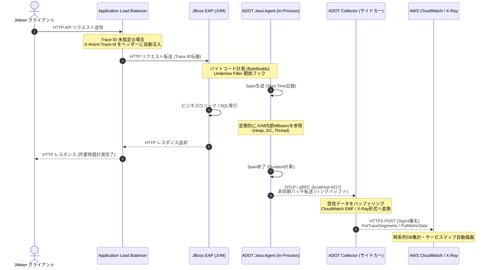
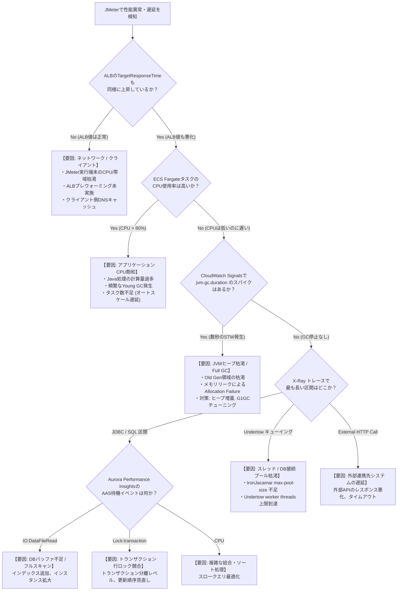

# 全体パフォーマンステスト（JMeter）におけるAWS可観測性統合ガイド
## 〜 API計測時の監視メトリクス・分散トレース・ECS Fargate JBoss EAP JVM/ヒープ完全解説 〜

---

## 目次
1. [エグゼクティブサマリー](#1-エグゼクティブサマリー)
2. [全体テストアーキテクチャとデータ収集フロー](#2-全体テストアーキテクチャとデータ収集フロー)
3. [JMeter計測時に確認すべきAWSサービスと指標一覧](#3-jmeter計測時に確認すべきawsサービスと指標一覧)
   - 3.1 Application Load Balancer (ALB)
   - 3.2 Amazon API Gateway
   - 3.3 Amazon ECS on AWS Fargate (Container Insights)
   - 3.4 AWS X-Ray / AWS Distro for OpenTelemetry (ADOT)
   - 3.5 Amazon Aurora / RDS
   - 3.6 Amazon ElastiCache for Redis
4. [【核心解説】ECS Fargate JBoss EAPのJVM・ヒープメモリ監視](#4-核心解説ecs-fargate-jboss-eapのjvmヒープメモリ監視)
   - 4.1 なぜECS標準のMemoryUtilizationではJVMヒープがわからないのか？
   - 4.2 JVM・ヒープ情報を確認できるAWSサービスと4つの実装手法
   - 4.3 4大アプローチの比較マトリクス
5. [動作原理とランタイム実行イメージの深掘り](#5-動作原理とランタイム実行イメージの深掘り)
   - 5.1 可観測性データパイプラインの動作原理
   - 5.2 JVMヒープ構造とGC（Garbage Collection）のメカニズム
   - 5.3 Fargateにおけるコンテナ認識と最適JVMオプション
6. [登場の歴史と背景・必要になった経緯](#6-登場の歴史と背景必要になった経緯)
   - 6.1 第1世代〜第5世代の監視アーキテクチャ進化論
   - 6.2 なぜ従来の監視手法（JMX RMI / SSH）はFargateで破綻したのか
7. [小学生でもわかる！たとえ話と図解ストーリー](#7-小学生でもわかるたとえ話と図解ストーリー)
   - 7.1 「巨大な遊園地とロボット執事の物語」
   - 7.2 子どもでもスッキリ納得するQ&A
8. [JMeter負荷試験時のボトルネック特定相関チェックシート](#8-jmeter負荷試験時のボトルネック特定相関チェックシート)

---

## 1. エグゼクティブサマリー

パフォーマンステストにおいて、クライアント側（Apache JMeter）で観測される指標（レスポンスタイム、スループット/TPS、エラー率）は**「結果」**に過ぎません。システムが目標性能を達成できない場合、あるいはリクエスト急増に伴い性能劣化が発生した場合、**「どこが・なぜ・どのように詰まっているのか」という根本原因（Root Cause）**を突き止めるには、AWSインフラからミドルウェア、JVM内部に至る**多層的な可観測性（Full-Stack Observability）**が不可欠です。

特に、**AWS ECS Fargate上で動作するRed Hat JBoss EAP（Java EE / Jakarta EE）**をバックエンドとするAPIシステムでは、従来の仮想マシン（Amazon EC2）やオンプレミス環境とは全く異なる**「コンテナ仮想化とJVMランタイムの二重構造」**および**「サーバレス（ホストOS不可視）の制約」**が存在します。

本書では、最新のAWS可観測性サービス（Amazon CloudWatch Application Signals、AWS Distro for OpenTelemetry、Container Insights、AWS X-Ray）を軸に、JMeter計測時に確認すべき全指標、およびJBoss EAPのJVM/ヒープメモリの監視手法を、動作原理・歴史的背景・直感的なたとえ話を交えて完全解説します。

---

## 2. 全体テストアーキテクチャとデータ収集フロー

以下の図は、JMeterによる負荷生成からAWS各サービスへのリクエスト到達、および各レイヤから可観測性基盤へのメトリクス・トレース・ログ収集パイプラインを示しています。

```mermaid
flowchart TD
    subgraph Client ["【負荷生成層】"]
        JM["Apache JMeter<br/>(シナリオ実行 / TPS計測 / エラー計測)"]
    end

    subgraph Edge_ALB ["【エントリ層】"]
        R53["Amazon Route 53<br/>(DNS名前解決)"]
        ALB["Application Load Balancer (ALB)<br/>TargetResponseTime / ActiveConn / 5xx"]
    end

    subgraph Fargate_Task ["【ECS Fargate タスク (awsvpc)】"]
        subgraph App_Container ["JBoss EAP アプリコンテナ"]
            JBoss["Red Hat JBoss EAP 7/8<br/>(OpenJDK 17/21)"]
            JVM["JVM ランタイム<br/>(Heap: Eden/Old, Non-Heap: Metaspace)"]
            Agent["ADOT Java Agent<br/>(-javaagent: Bytecode Instrumentation)"]
        end
        subgraph Sidecar_Container ["サイドカーコンテナ"]
            ADOT_Col["AWS Distro for OpenTelemetry (ADOT)<br/>Collector (gRPC :4317)"]
            FluentBit["AWS FireLens<br/>(Fluent Bit Log Router)"]
        end
    end

    subgraph Data_Layer ["【データ永続層】"]
        Aurora[("Amazon Aurora (PostgreSQL/MySQL)<br/>CPU / AAS / Wait Events")]
        Redis[("Amazon ElastiCache for Redis<br/>EngineCPU / Memory / Evictions")]
    end

    subgraph Observability_Plane ["【AWS 可観測性基盤 (CloudWatch / X-Ray)】"]
        CW_Metrics["CloudWatch Metrics<br/>(ALB, ECS, RDS, Redis 基本指標)"]
        CW_Signals["CloudWatch Application Signals<br/>(JVMヒープ, GC停止時間, SLO, サービスマップ)"]
        CW_Logs["CloudWatch Logs & Insights<br/>(GC詳細ログ, Undertowアクセスログ)"]
        XRay["AWS X-Ray<br/>(分散トレース / ボトルネック区間可視化)"]
        PI["RDS Performance Insights<br/>(Top SQL / 待機イベント分析)"]
    end

    %% リクエストフロー
    JM -->|HTTPS リクエスト| ALB
    ALB -->|HTTP/1.1 or HTTP/2| JBoss
    JBoss -->|JDBC (IronJacamar Pool)| Aurora
    JBoss -->|RESP Protocol| Redis

    %% メトリクス・トレース・ログ収集フロー
    ALB -.->|標準メトリクス| CW_Metrics
    Agent -.->|OTLP gRPC (localhost)| ADOT_Col
    ADOT_Col -.->|SigV4 HTTPS / EMF| CW_Signals
    ADOT_Col -.->|PutTraceSegments| XRay
    JVM -.->|-Xlog:gc* 標準出力/ファイル| FluentBit
    FluentBit -.->|ログストリーム| CW_Logs
    Aurora -.->|Telemetry| CW_Metrics
    Aurora -.->|Session Data| PI
    Redis -.->|Telemetry| CW_Metrics
```

---

## 3. JMeter計測時に確認すべきAWSサービスと指標一覧

JMeterで負荷を印加している最中に、リアルタイムおよび事後分析で確認すべきAWSサービスと、その監視指標を整理します。

### 3.1 Application Load Balancer (ALB)
ALBはシステムのエントリポイントであり、JMeterが体感するレスポンスタイムとバックエンド処理時間の「乖離」を切り分ける最重要ポイントです。

| メトリクス名 | 統計値 | 正常目安 | 危険閾値 | パフォーマンス上の意味と監視目的 | 劣化時の原因と調査アクション |
| :--- | :--- | :--- | :--- | :--- | :--- |
| **`TargetResponseTime`** | Average, p90, p99 | < 0.5s | p99 > 1.0s / 急上昇 | ALBがターゲット(ECS)にリクエストを送ってから応答完了までの時間。**JMeterレスポンスタイムとの差分でネットワーク遅延を判定**。 | JBoss EAPのUndertowスレッド枯渇、JVM Full GC停止、DBスロークエリを調査。 |
| **`RequestCount`** | Sum | 計画TPS | 急激な頭打ち | 実際にターゲットへ届いたリクエスト総数。 | JMeter負荷機の性能限界、または途中のWAF/ネットワークでの遮断を疑う。 |
| **`ActiveConnectionCount`** | Average / Sum | 安定 | 際限なく増加 | クライアントおよびターゲットとの間で開かれているアクティブなTCP接続数。 | JBoss側の処理遅延によるコネクション滞留、Keep-Aliveの不適切な長期保持。 |
| **`NewConnectionCount`** | Sum | スループット比例 | 乱高下 / スパイク | 新規に確立されたTCP接続数。 | 接続確立オーバーヘッド(SSLハンドシェイク)の負荷増大。JMeterのKeep-Alive有効化を確認。 |
| **`HTTPCode_Target_5XX_Count`** | Sum | 0 | > 0 | JBoss EAP（ターゲット）が明示的に返却した5xxエラー。 | Javaコード内のUnhandled Exception、DB接続プール枯渇、トランザクションタイムアウト。 |
| **`HTTPCode_ELB_502_Count`** | Sum | 0 | > 0 | **Bad Gateway**。ALBがECSタスクに接続できなかった、または応答途中でタスクが切断された。 | **FargateタスクのOOMKilled（Exit Code 137）による強制死**、ヘルスチェック失敗による強制終了。 |
| **`HTTPCode_ELB_503_Count`** | Sum | 0 | > 0 | **Service Unavailable**。リクエストをルーティング可能な正常ターゲットが存在しない。 | 全タスクのヘルスチェック失敗、オートスケーリングの起動遅延。 |
| **`HTTPCode_ELB_504_Count`** | Sum | 0 | > 0 | **Gateway Timeout**。ALBのアイドルタイムアウト(デフォルト60s)までにターゲットが無応答。 | JBossスレッドのデッドロック、無限ループ、巨大トランザクションのDBロック待ち。 |
| **`UnHealthyHostCount`** | Max | 0 | > 0 | ALBヘルスチェックに失格したECSタスク数。 | JBossがGC停止(STW)でヘルスチェックURLに応答できない、CPU100%飽和。 |
| **`RejectedConnectionCount`** | Sum | 0 | > 0 | ALBの最大接続数超過・サージキュー溢れによる接続拒否。 | ALBのキャパシティ不足。負荷試験前の**AWSプレウォーミング申請**が必要。 |

### 3.2 Amazon API Gateway
REST APIのフロントエンドにAPI Gatewayを採用している場合、ALBとは異なるレイヤで遅延が発生します。

| メトリクス名 | 正常目安 | 危険閾値 | パフォーマンス上の意味 | 切り分けポイント |
| :--- | :--- | :--- | :--- | :--- |
| **`Latency`** | 要件値以内 | スパイク | API Gatewayがクライアントからリクエストを受信してから応答を返すまでの全時間。 | 全体遅延（API GW自身のオーバヘッド＋統合遅延）。 |
| **`IntegrationLatency`** | 要件値以内 | 急上昇 | API Gatewayがバックエンド（ECS/ALB）にリクエストを転送してから応答を受け取るまでの時間。 | **`Latency` - `IntegrationLatency` = API Gateway自身の処理時間（認可オーソライザー等）**。 |
| **`4XXError` / `5XXError`** | 0 | > 0 | クライアント起因/サーバ起因のエラー率。 | 429 Throttle発生時はAPI Gatewayのスロットリング制限（デフォルト10,000 RPS）超過。 |

### 3.3 Amazon ECS on AWS Fargate (Container Insights)
Container Insightsを有効化することで、Fargateタスク単位・コンテナ単位のcgroupメトリクスを収集します。

| メトリクス名 | 単位 | 危険閾値 | パフォーマンス上の意味と監視目的 |
| :--- | :--- | :--- | :--- |
| **`CpuUtilized` / `CPUUtilization`** | Percent (%) | > 80% (継続) | Fargateタスクに割り当てられた仮想CPU（vCPU）の使用率。高すぎるとCPUスロットリングが発生し、全スレッドの実行が著しく遅延する。 |
| **`MemoryUtilized` / `MemoryUtilization`** | Bytes / % | > 85% | **コンテナ全体のcgroupメモリ消費量**。JVMヒープだけでなく、Metaspace、スレッドスタック、ネイティブメモリ、OSページキャッシュを含む。100%でOOMKilled。 |
| **`NetworkRxBytes` / `NetworkTxBytes`** | Bytes/sec | 急激な頭打ち | ネットワークI/O。Fargateのタスクサイズ毎に割り当てられているネットワーク帯域上限に達していないかを確認。 |
| **`StorageReadBytes` / `StorageWriteBytes`**| Bytes/sec | 異常スパイク | エフェメラルストレージへのディスクI/O。過剰なアプリケーションログ出力や一時ファイル生成によるディスクウェイトを検知。 |

### 3.4 AWS X-Ray / AWS Distro for OpenTelemetry (ADOT)
JMeterで「レスポンスが遅い」と判明したリクエストの内部構造を透視します。

```
[クライアント (JMeter)]
   │ (HTTP GET /api/v1/orders/12345) ── [Trace ID: 1-6789abcd-...]
   ▼
[ALB] ────────────────────────── (所要時間: 450ms)
   │
   ▼
[ECS Fargate: JBoss EAP] ─────── (所要時間: 442ms)
   ├─ Undertow HTTP Filter ───── (2ms)
   ├─ OrderService.getOrder() ── (5ms)
   ├─ JDBC: SELECT * FROM orders (420ms) ◀── 【★ボトルネック特定！】
   └─ JSON Serialization ────── (15ms)
```

- **`Trace Duration`**: リクエストのE2E所要時間のパーセンタイル（p50, p90, p99）分布。
- **`Subsegment Duration`**: JBoss内部の処理ブロック別所要時間。
  - **Servlet/Filter実行時間**: アプリケーションコードに入る前のキューイング時間。
  - **EJB / Serviceメソッド実行時間**: 純粋なJavaビジネスロジックの計算時間。
  - **JDBC / SQLクエリ実行時間**: データベース待ち時間（最もボトルネックになりやすい）。
  - **External HTTP Call**: 外部決済APIや他マイクロサービスの呼び出し時間。
- **`FaultRate` / `ErrorRate`**: 5xx系障害および4xx系エラーの発生比率。例外スタックトレースの直接参照が可能。

### 3.5 Amazon Aurora / RDS（バックエンドデータベース）
API処理のボトルネックの大半はデータベースに潜んでいます。

- **`CPUUtilization`**: 80%超過時はクエリ最適化またはインスタンススケールアップが必要。
- **`DatabaseConnections`**: JBoss EAPのデータソース接続プール（IronJacamar `max-pool-size`）の合計値と比較し、枯渇していないかを監視。
- **`ReadLatency` / `WriteLatency`**: 1桁ミリ秒（< 5ms〜10ms）が目安。急増時はI/O競合。
- **Performance Insights (AAS: Average Active Sessions)**:
  - **最大vCPUライン（破線）**: AASがvCPU数を超えている場合、セッションがCPUやI/Oを求めて待機行列を作っている（過負荷状態）。
  - **待機イベント（Wait Events）の特定**:
    - `CPU`: 純粋にSQLクエリの計算量が多い（インデックスなし、全件走査）。
    - `IO:DataFileRead`: 共有バッファ（メモリ）にデータがなく、ストレージからブロックを読み込んでいる（キャッシュヒット率低下）。
    - `Lock:transaction` / `Lock:tuple`: 複数トランザクション間の行ロック・テーブルロック競合（排他制御の衝突）。

### 3.6 Amazon ElastiCache for Redis
- **`EngineCPUUtilization` (最重要)**:
  - Redisはコマンド処理を**単一スレッド（イベントループ）**で実行するため、マルチコアインスタンスであっても**EngineCPUUtilizationが100%に達すると完全に詰まります**。
  - ※通常の`CPUUtilization`はOS全体（全コア平均）を示すため、4コアマシンでは`EngineCPUUtilization`が100%でも`CPUUtilization`は25%程度にしかならず、**見落としの最大の原因**となります。
- **`Evictions`**: メモリ上限（`maxmemory`）超過により、有効期限前のキーが強制破棄された件数。0であるべき。

---

## 4. 【核心解説】ECS Fargate JBoss EAPのJVM・ヒープメモリ監視

### 4.1 なぜECS標準のMemoryUtilizationではJVMヒープがわからないのか？

多くのエンジニアが負荷試験で陥る**最大の落とし穴**がここにあります。

> **「ECSのMemoryUtilizationが70%で安定しているから、メモリは全く問題ない」**
> → **大間違いです！ JVM内部のヒープは99%枯渇しており、Full GCでシステムが死にかけている可能性があります。**

#### 構造的相違の図解
```
┌────────────────────────────────────────────────────────────────────────┐
│  ECS Fargate タスク全体の制限 (Task Memory: 例 4096MB)                  │
│                                                                        │
│  ┌──────────────────────────────────────────────────────────────────┐  │
│  │ Linux cgroup (ECSメトリクス `MemoryUtilized` が見ている範囲)      │  │
│  │                                                                  │  │
│  │  ┌────────────────────────────────────────────────────────────┐  │  │
│  │  │ JVM プロセス全体のメモリ使用量                             │  │  │
│  │  │                                                            │  │  │
│  │  │  ┌──────────────────────────────────────────────────────┐  │  │  │
│  │  │  │ 【JVM ヒープ領域】 (ECS標準メトリクスからは不可視！) │  │  │  │
│  │  │  │  - Eden Space (新規オブジェクト)                      │  │  │  │
│  │  │  │  - Survivor Space (S0 / S1)                          │  │  │  │
│  │  │  │  - Old Generation (長期生存オブジェクト / キャッシュ)│  │  │  │
│  │  │  └──────────────────────────────────────────────────────┘  │  │  │
│  │  │                                                            │  │  │
│  │  │  ┌──────────────────────────────────────────────────────┐  │  │  │
│  │  │  │ 【JVM 非ヒープ領域 (Non-Heap)】                      │  │  │  │
│  │  │  │  - Metaspace (クラスメタデータ)                      │  │  │  │
│  │  │  │  - Thread Stack (各スレッドのスタック: 1MB × 本数)  │  │  │  │
│  │  │  │  - Code Cache (JITコンパイル済みネイティブコード)     │  │  │  │
│  │  │  │  - Direct Memory Buffers (Undertow等のOff-Heap)      │  │  │  │
│  │  │  └──────────────────────────────────────────────────────┘  │  │  │
│  │  │                                                            │  │  │
│  │  │  ┌──────────────────────────────────────────────────────┐  │  │  │
│  │  │  │ JVM内部C++ヒープ / glibc malloc / 共有ライブラリ     │  │  │  │
│  │  │  └──────────────────────────────────────────────────────┘  │  │  │
│  │  └────────────────────────────────────────────────────────────┘  │  │
│  │                                                                  │  │
│  │  OS ページキャッシュ / バッファ / シェルプロセス                 │  │
│  └──────────────────────────────────────────────────────────────────┘  │
└────────────────────────────────────────────────────────────────────────┘
```

#### なぜ乖離が生じるのか？（3つの決定的な理由）
1. **JVMのメモリ保持の習性**:
   - JVMは起動時または負荷上昇時にOSからメモリ（ヒープ）を一度確保すると、GCを実行して内部のオブジェクトが解放されても、**OSにはメモリを簡単には返却しません（プロセスの仮想メモリ・常駐セットRSSとして保持し続ける）**。
   - そのため、cgroupから見た`MemoryUtilized`は常に高止まり（例: 80%）のまま平坦な直線を描き、内部でGCが順調に回っているのか、それともメモリリークでパンク寸前なのかが一切判別できません。
2. **非ヒープ領域の存在**:
   - JBoss EAPは多数のモジュール・クラスをロードするため、**Metaspace**や**スレッドスタック（Undertowワーカー500本×1MB＝500MB）**、**ダイレクトバッファ（Netty/Undertowの高速I/Oバッファ）**が大量のメモリを消費します。
   - ヒープ上限（`-Xmx`）を3GBにしていても、非ヒープが1.2GB消費すれば合計4.2GBとなり、Fargateの4GB上限を突き破ります。
3. **OOM発生時の運命の違い**:
   - **JVMヒープ枯渇**: JVM自身が `java.lang.OutOfMemoryError: Java heap space` を投げ、ログにスタックトレースが残り、設定次第でHeap Dumpを出力可能。
   - **cgroupメモリ枯渇**: LinuxカーネルのOOM Killerが発動し、プロセスに容赦なく `SIGKILL (シグナル 137)` を送り即死させます。JVMは遺言（ログやダンプ）を1行も残せず、ECSイベントに `Task stopped with exit code 137` とだけ記録されます。

---

### 4.2 JVM・ヒープ情報を確認できるAWSサービスと4つの実装手法

ECS Fargate内のJBoss EAPからJVM/ヒープ情報をAWS上で確認するには、以下の**4つのアプローチ**が存在します。

---

#### 【アプローチ1（最新・最推奨）】Amazon CloudWatch Application Signals
> **2023年末〜2024年にAWSが正式リリースした次世代APM（アプリケーションパフォーマンスモニタリング）機能。2026年現在のベストプラクティス。**

##### 仕組みと特徴
- コンテナコードを一切改修することなく、タスク定義に**AWS Distro for OpenTelemetry (ADOT) Java Agent**をマウント・注入するだけで、JVMメトリクスと分散トレースを自動収集します。
- CloudWatchコンソール上に**「Application Signals」専用ダッシュボード**が自動生成され、Javaのヒープ・GC・スレッドが即座にグラフ化されます。

##### 確認可能な具体的メトリクス
- **`jvm.memory.used`**:
  - ディメンション `jvm.memory.type`: `heap`（ヒープ） / `non_heap`（非ヒープ）
  - ディメンション `jvm.memory.pool.name`:
    - `G1 Eden Space`（Eden領域使用量）
    - `G1 Survivor Space`（Survivor領域使用量）
    - `G1 Old Gen`（Old領域使用量 ★最重要★）
    - `Metaspace`（メタスペース使用量）
    - `CodeHeap 'non-nmethods'` / `CodeHeap 'profiled nmethods'`
- **`jvm.memory.limit`**: ヒープ最大サイズ（`-Xmx` に相当）
- **`jvm.memory.committed`**: JVMがOSから実際にコミット確保しているメモリ量
- **`jvm.gc.duration`**:
  - ガベージコレクションに伴う**Stop-The-World (STW) 停止時間（ミリ秒）**。
  - ディメンション `jvm.gc.action`: `end of minor GC`（Young GC） / `end of major GC`（Full GC）
- **`jvm.thread.count`**: JVM内でアクティブに稼働しているスレッド本数

##### Fargateタスク定義への組み込み設定例（ゼロコード自動計装）
```json
{
  "containerDefinitions": [
    {
      "name": "jboss-eap-app",
      "image": "my-account.dkr.ecr.ap-northeast-1.amazonaws.com/jboss-eap:latest",
      "essential": true,
      "environment": [
        {
          "name": "JAVA_OPTS",
          "value": "-javaagent:/opt/aws-opentelemetry-agent.jar -XX:+UseContainerSupport -XX:MaxRAMPercentage=70.0"
        },
        {
          "name": "OTEL_SMP_ENABLED",
          "value": "true"
        },
        {
          "name": "OTEL_AWS_APPLICATION_SIGNALS_ENABLED",
          "value": "true"
        },
        {
          "name": "OTEL_RESOURCE_ATTRIBUTES",
          "value": "service.name=jboss-order-api,aws.host.name=fargate"
        },
        {
          "name": "OTEL_EXPORTER_OTLP_PROTOCOL",
          "value": "grpc"
        },
        {
          "name": "OTEL_EXPORTER_OTLP_ENDPOINT",
          "value": "http://127.0.0.1:4317"
        }
      ],
      "dependsOn": [
        {
          "containerName": "aws-otel-collector",
          "condition": "START"
        }
      ]
    },
    {
      "name": "aws-otel-collector",
      "image": "public.ecr.aws/aws-observability/aws-otel-collector:latest",
      "essential": true,
      "environment": [
        {
          "name": "APPLICATION_SIGNALS_ENABLED",
          "value": "true"
        }
      ]
    }
  ]
}
```

---

#### 【アプローチ2】CloudWatch Container Insights with Prometheus（JMX Exporter経由）
> **JBoss EAP固有のMBeans（DBコネクションプール数やUndertow統計）まで詳細に収集したい場合のエンタープライズ構成。**

##### 仕組みと特徴
- JBoss EAPプロセスに Prometheus の `jmx_prometheus_javaagent.jar` をロードさせ、内部のJMX MBean情報をHTTPエンドポイント（例: `http://localhost:9404/metrics`）で公開。
- 同一タスク内のADOT CollectorサイドカーがこのエンドポイントをPrometheusプロトコルで定期スクレイピング（数秒〜1分間隔）。
- ADOT CollectorがCloudWatch EMF（Embedded Metric Format）形式に変換し、CloudWatch Metricsのカスタム名前空間（例: `ECS/ContainerInsights/Prometheus`）へ自動送信。

##### 確認可能なメトリクス例
- `jvm_memory_bytes_used{area="heap"}`: ヒープ使用バイト数
- `jvm_memory_bytes_max{area="heap"}`: ヒープ最大バイト数
- `jvm_gc_collection_seconds_sum`: GC累計所要秒数
- **`jboss_as_subsystem_datasources_data_source_active_count`**: **JBossデータソースの現在アクティブ接続数**
- **`jboss_as_subsystem_datasources_data_source_available_count`**: **JBossデータソースの空き接続数**
- **`jboss_as_subsystem_undertow_server_request_count`**: **Undertowが処理した総HTTPリクエスト数**

---

#### 【アプローチ3】CloudWatch Logs Insights による GCログ構造化解析
> **メトリクス（集計値）だけでは見抜けない、「一時オブジェクトの急増」「巨大オブジェクト（Humongous Object）の割り当て」をミリ秒精度で完全解剖する手法。**

##### 仕組みと特徴
- Java 17/21の統合ログ機能（`-Xlog:gc*`）を有効化し、GCログを非同期に出力。
- AWS FireLens（Fluent Bitサイドカー）経由でAmazon CloudWatch Logsへリアルタイムストリーミング。
- 負荷試験後、**CloudWatch Logs Insights**のクエリを用いて、GC停止時間の最大値・p99、およびヒープ解放量を集計。

##### JBoss EAP JVM引数の推奨設定
```bash
JAVA_OPTS="$JAVA_OPTS -Xlog:gc*,gc+phases=debug,gc+safepoint=info:file=/opt/jboss/logs/gc.log:time,uptime,pid,level,tags:filecount=5,filesize=50M"
```

##### CloudWatch Logs Insights 解析クエリ例（GC停止時間のTOP20特定）
```sql
fields @timestamp, @message
| filter @message like /Pause Young/ or @message like /Pause Full/
| parse @message /Pause (?:Young|Full) \(.*?\) (?<pause_time_ms>[0-9\.]+)ms/
| sort pause_time_ms desc
| limit 20
```

---

#### 【アプローチ4】Amazon ECS Exec によるリアルタイムCLI診断（jcmd / JBoss CLI）
> **負荷試験の実行中、特定タスクの応答が急激に悪化した瞬間に、現場で直接JVM内部を「生診断」する緊急対応手法。**

##### 仕組みと特徴
- AWS Systems Manager（SSM）Session Managerの仕組みを利用し、Fargateコンテナに対話シェルでセキュアにログイン（SSHデーモン不要）。
- JDK標準の診断コマンド `jcmd` や、JBoss EAPの管理ツール `jboss-cli.sh` を直接実行。

##### 実行手順と診断コマンド
```bash
# 1. 稼働中のFargateタスクへログイン
aws ecs execute-command \
    --cluster my-perf-cluster \
    --task <TASK_ID> \
    --container jboss-eap-app \
    --interactive \
    --command "/bin/bash"

# 2. JVMヒープメモリ内訳の即時表示
jcmd 1 GC.heap_info

# 実行結果例:
# garbage-first heap   total 2097152K, used 1548288K [0x0000000780000000, 0x0000000800000000)
#   region size 2048K, 230 young (471040K), 12 survivor (24576K)
#  Metaspace       used 184512K, committed 188416K, reserved 1228800K

# 3. JBoss CLIによるプラットフォームMBeanの直接参照
$JBOSS_HOME/bin/jboss-cli.sh --connect --command="/core-service=platform-mbean/type=memory:read-attribute(name=heap-memory-usage)"
```

---

### 4.3 4大アプローチの比較マトリクス

| 評価項目 | 方式1: CloudWatch Application Signals | 方式2: Container Insights + JMX | 方式3: CloudWatch Logs Insights (GCログ) | 方式4: ECS Exec + CLI |
| :--- | :--- | :--- | :--- | :--- |
| **主な用途** | **常時監視・SLO追跡・ダッシュボード** | **JBoss特有指標(DB/スレッド)の深掘り** | **事後詳細分析・GCチューニング** | **障害発生時の緊急リアルタイム診断** |
| **可視化場所** | CloudWatch Application Signals コンソール | CloudWatch Metrics (Prometheus) | CloudWatch Logs Insights | ターミナル (CLI直接出力) |
| **実装難易度** | **低（環境変数・Agent設定のみ）** | 中（サイドカー定義とYAML設定） | 低〜中（JVMログ引数＋FireLens） | 低（ECSタスク定義で有効化のみ） |
| **アプリ改修** | **ゼロ（コード修正不要）** | ゼロ（JMX Agent追加のみ） | ゼロ（起動引数追加のみ） | ゼロ |
| **リアルタイムアラーム**| **◎ 可能（CloudWatch Alarms即時連動）** | **◎ 可能** | ○ メトリクスフィルター経由で可能 | × 不可（アドホック実行） |
| **JBoss固有MBean** | △ JVM標準指標が主 | **◎ Undertow/DBプール完全網羅** | × GCログのみ | **◎ CLIから全て参照可能** |
| **総合推奨度** | **★★★★★ (最優先で導入すべきデファクト)**| **★★★★☆ (要件に応じて併用)** | **★★★★☆ (試験時の分析用に必須)** | **★★★☆☆ (トラブルシューティング用)**|

---

## 5. 動作原理とランタイム実行イメージの深掘り

### 5.1 可観測性データパイプラインの動作原理

ADOT Java Agentを適用したJBoss EAPが、リクエストを処理しながらいかにして低負荷でメトリクス・トレースをCloudWatch/X-Rayに届けるのか、その内部パイプラインのメカニズムを解説します。



#### 重要ポイント: なぜ負荷試験中に計測オーバーヘッドが極小なのか？
1. **バイトコード動的計装（Dynamic Bytecode Instrumentation）**:
   ソースコードの変更は一切不要で、クラスローダーがクラスをメモリにロードする瞬間に、OpenTelemetry Agentがメソッドの入口と出口に極小のフックコード（バイトコード）を挿入します。
2. **非同期リングバッファ（LMAX Disruptor構造）**:
   トレースの生成やメトリクスの収集は、HTTPリクエストを処理するアプリケーションスレッドをブロックしません。インメモリのロックフリー・リングバッファに即座に格納され、バックグラウンドのワーカースレッドがバッチ単位でサイドカーへ送信します。
3. **ローカルループバック通信（awsvpcモード）**:
   ECS Fargateでは、タスク内の全コンテナが同一の仮想ネットワークインターフェース（ENI）と`localhost (127.0.0.1)`を共有します。アプリコンテナからサイドカーへの転送はOS内部のソケット通信で行われるため、ネットワークI/Oオーバーヘッドはほぼゼロです。

---

### 5.2 JVMヒープ構造とGC（Garbage Collection）のメカニズム

Java 17/21で標準の**G1GC (Garbage-First Garbage Collector)**を前提としたヒープの内部挙動を理解することは、JMeterのスパイク遅延を解明する上で必須です。

```
┌────────────────────────────────────────────────────────────────────────┐
│  G1GC のヒープレイアウト (ヒープ全体を数千個の「リージョン」に均等分割)    │
│                                                                        │
│  [ E ] [ E ] [ S ] [   ] [ O ] [ O ] [ E ] [   ] [ H ] [ O ] [ S ] ... │
│                                                                        │
│   E : Eden リージョン (新規作成)        O : Old リージョン (長期生存)   │
│   S : Survivor リージョン (生存移動)   H : Humongous (巨大オブジェクト)│
│   [ ]: フリー (未割り当て) リージョン                                  │
└────────────────────────────────────────────────────────────────────────┘
```

#### 1. Eden領域（新規作成の遊び場）
- JMeterからリクエストが来ると、コントローラやDTO、JSON文字列などのオブジェクトがEdenリージョンに猛スピードで割り当てられます。
- Edenが満杯になると**「Minor GC（Young GC）」**が発動します。
- **挙動**: 生き残ったオブジェクトだけをSurvivorリージョンにコピーし、元のEdenリージョンを一瞬で全クリア（再利用可能）にします。数ミリ秒〜数十ミリ秒で完了するため、通常は問題になりません。

#### 2. Survivor領域（選抜試験場）
- Minor GCを生き延びたオブジェクトはSurvivorに移動し、GCをパスするたびに**「エイジ（年齢）」**が1つずつ加算されます。
- 一定の年齢（デフォルト15、または`-XX:MaxTenuringThreshold`で指定）に達したオブジェクトは、「これは一時的なリクエストデータではなく、セッションやキャッシュなどの長期生存データである」と認定され、Old領域へ**「昇格（Promotion）」**します。

#### 3. Old領域（長期滞在者の街）と IHOP
- Old領域の使用率が一定の割合（`-XX:InitiatingHeapOccupancyPercent=45`、デフォルト45%）を超えると、G1GCはバックグラウンドでアプリケーションを止めずにゴミを探す**「Concurrent Marking（並行マーキング）」**を開始します。
- この並行マーキングが順調に完了すれば、ゴミの多いOldリージョンが段階的に回収され（Mixed GC）、大きな停止は起きません。

#### 4. 最悪の悪夢: Full GC と Stop-The-World (STW)
- JMeterで想定以上の超高負荷をかけた場合、**「オブジェクトの生成速度」が「G1GCの回収速度」を上回ってしまいます（Allocation Failure）**。
- Old領域に空きがなくなり、巨大オブジェクト（リージョンサイズの50%を超える配列やバッファ）を置く場所がなくなると、G1GCは最後の手段として**「Full GC」**を発動します。
- **挙動**: **すべてのアプリケーションスレッドを完全にフリーズ（Stop-The-World）**させ、シングルスレッドまたは全コアを使ってヒープ全体を総点検・コンパクション（再配置）します。
- **結果**: **この数秒〜数十秒間、JBoss EAPは文字通り「ピタッと凍結」**し、HTTPリクエストに一切応答できなくなります。JMeter側ではレスポンスタイムが垂直立ち上がりし、ALBは「ターゲットが死んだ」と判断して**HTTP 502/504**を吐き出します。

---

### 5.3 Fargateにおけるコンテナ認識と最適JVMオプション

コンテナ環境でJavaを安全かつ高性能に動作させるには、**OpenJDKのコンテナエルゴノミクス（Container Ergonomics）**を正しく制御する必要があります。

#### 黄金律: JVMにコンテナ境界を正しく教える
```bash
# 推奨 JVM オプション設定（JBoss EAP on Fargate）
JAVA_OPTS=" \
  -XX:+UseContainerSupport \
  -XX:MaxRAMPercentage=70.0 \
  -XX:InitialRAMPercentage=70.0 \
  -XX:MinRAMPercentage=70.0 \
  -XX:+UseG1GC \
  -XX:InitiatingHeapOccupancyPercent=45 \
  -XX:G1ReservePercent=15 \
  -XX:MetaspaceSize=256m \
  -XX:MaxMetaspaceSize=512m \
  -XX:+ExitOnOutOfMemoryError \
  -XX:+HeapDumpOnOutOfMemoryError \
  -XX:HeapDumpPath=/tmp/heapdump.hprof \
"
```

1. **`-XX:+UseContainerSupport`**:
   - JVMがLinuxのcgroup制限（Fargateタスクのメモリ割り当て量）を自動認識します（Java 8u191以降、Java 11/17/21ではデフォルト有効）。
2. **`-XX:MaxRAMPercentage=70.0`**:
   - `-Xmx`を絶対値（例: `-Xmx3g`）で固定するのではなく、**コンテナ割当メモリに対する割合（パーセンテージ）で指定**します。
   - なぜ70%なのか？ 残りの30%を、**Metaspace、スレッドスタック、ダイレクトバッファ、OSネイティブメモリ、およびADOTサイドカー等に安全マージンとして確保するため**です。これを90%などに設定すると、高負荷時に即座にcgroup OOM Killerに撃ち殺されます。
3. **`-XX:+ExitOnOutOfMemoryError`**:
   - ヒープ枯渇でOutOfMemoryErrorが発生した際、ゾンビ状態で中途半端に応答を続けさせず、**JVMを即座にプロセス停止させます**。
   - これにより、ECSのヘルスチェックおよびタスク再起動メカニズムが即座に作動し、死んだタスクを正常な新品タスクに自動置換（Self-Healing）させることができます。

---

## 6. 登場の歴史と背景・必要になった経緯

なぜ現代のエンジニアは、これほど洗練された（かつ複雑な）可観測性アーキテクチャを構築しなければならなくなったのでしょうか？ その歴史的変遷と必然性を紐解きます。

```
【第1世代】オンプレミス・物理サーバ ─── (手動・RMI接続・固定IP)
   │
   ▼ クラウド仮想マシンの登場 (リソースの柔軟性)
【第2世代】AWS EC2 仮想マシン ───────── (CloudWatch基本監視・OS内部はブラックボックス)
   │
   ▼ コンテナ技術の爆発 (ポータビリティと高密度化)
【第3世代】Docker黎明期 ──────────────── (Javaのcgroup無認識・OOM即死事件)
   │
   ▼ サーバレス運用の希求 (ホストOS管理からの完全解放)
【第4世代】AWS ECS Fargate ───────────── (SSH不可・RMI破綻・Push型への強制進化)
   │
   ▼ 分散マイクロサービスの複雑化 (標準化への収束)
【第5世代】現代 (2024-2026) ───────────── (OpenTelemetry標準・CloudWatch Application Signals)
```

### 6.1 各世代の詳細と「なぜ困ったか（Pain Point）」

#### 第1世代: オンプレミス物理サーバとJBoss AS（1990年代後半〜2000年代）
- **環境**: データセンターのラックに固定された高価な物理サーバ。IPアドレスは永久固定。
- **監視手法**: SNMPによる死活監視、運用者がターミナルからSSHで入って`top`コマンド監視。Java監視には**JConsole**や**VisualVM**を使い、ネットワーク越しに**JMX RMI（リモートメソッド呼び出し: ポート1099や9999）**で直接接続。
- **なぜ破綻したか**:
  - JMX RMI接続は通信が重く、負荷試験中に監視ツールを接続した瞬間にRMI自体の通信負荷でJBossサーバがクラッシュする本末転倒な事故が頻発。
  - ファイアウォールで固定ポートを開ける必要があり、セキュリティ上の重大な弱点となった。

#### 第2世代: AWS EC2仮想マシンと初期CloudWatch（2006年〜2014年頃）
- **環境**: クラウド上の仮想マシン（EC2）。
- **監視手法**: Amazon CloudWatchが誕生。ハイパーバイザー（外側）からCPU使用率やディスクI/O、ネットワークトラフィックが自動計測されるようになった。
- **なぜ破綻したか**:
  - **「OS内部のメモリ」がCloudWatchから見えない！** ハイパーバイザーはVMに割り当てたメモリがOS内部でどう使われているか知る術がありませんでした。
  - そのため、「CloudWatchのCPUは30%なのに、OS内部でJavaヒープが枯渇してシステムが停止する」という事態に直面。EC2内部にCloudWatch Logs Agentを手動インストールしてOSメトリクスを送信する追加作業が必須となりました。

#### 第3世代: Dockerコンテナ黎明期（2014年〜2018年頃）
- **環境**: DockerコンテナをEC2上にデプロイして高密度運用。
- **大事件: 初期Java 8の「cgroup無認識による即死事件」**:
  - 当時のJVM（Java 8u131以前）は、Linuxのコンテナ隔離機能（cgroup）を理解できませんでした。
  - たとえば64GBのホストEC2上で「2GB制限」のDockerコンテナを立ち上げても、JVMは「おっ、メモリが64GBもあるぞ！」と勘違いし、デフォルトで16GB（ホストの1/4）のヒープを確保しようとしました。
  - その結果、**コンテナが起動した瞬間に2GBのcgroup制限を超過し、LinuxカーネルのOOM Killerによって即座に射殺（SIGKILL 137）される**というトラブルが世界中で多発しました。
  - これを機に、JavaコミュニティはOpenJDK 8u191およびJava 10以降で`-XX:+UseContainerSupport`を実装し、コンテナの壁を認識できるよう改良しました。

#### 第4世代: AWS ECS Fargate サーバレスコンテナ（2018年〜2022年頃）
- **環境**: ホストOSの管理をAWSに完全委譲するサーバレスコンテナ基盤「AWS Fargate」の登場。
- **なぜ従来の監視が通用しなくなったか**:
  1. **ホストOSが存在しない（SSHログイン不可）**: OSエージェントを自由にインストールする場所がありません。
  2. **動的IPとエフェメラル（使い捨て）タスク**: Fargateタスクはオートスケーリングで数分ごとに起動・破棄され、プライベートIPが毎回変わります。そのため、JConsole等の**「固定IPに外から繋ぎにいくPull型監視」は完全に息の根を止められました**。
  3. **解決策の模索**: アプリケーション自身が外部へメトリクスを能動的に送信する**「Push型アーキテクチャ（サイドカー方式）」**へのパラダイムシフトが起きました。

#### 第5世代: 現代（2023年末〜2026年）OpenTelemetryとCloudWatch Application Signals
- **環境**: 分散マイクロサービス、Jakarta EE（JBoss EAP 8）、クラウドネイティブ。
- **必然性と進化**:
  - 従来は「メトリクスはPrometheus、トレースはX-Ray SDK、ログはFluent Bit」とツールが乱立し、エンジニアはそれぞれ個別のライブラリをコードに埋め込む膨大な労力を強いられていました。
  - CNCF（Cloud Native Computing Foundation）により業界標準仕様**「OpenTelemetry (OTel)」**が確立。
  - これを受け、AWSは**CloudWatch Application Signals**および**AWS Distro for OpenTelemetry (ADOT)**をローンチ。
  - **結論**: **コード改修を1行もすることなく、タスク定義の設定だけでJVMヒープ・GC停止時間・分散トレース・SLO（サービスレベル目標）が一気通貫で手に入る新時代**が到来しました。

---

## 7. 小学生でもわかる！たとえ話と図解ストーリー

難しい専門用語をすべて日常の身近な世界に置き換えて、この仕組みを小学生にもわかるように説明します！

### 7.1 「巨大な遊園地とロボット執事の物語」

```
┌────────────────────────────────────────────────────────────────────────┐
│                      【夢のハイテク遊園地】                            │
│                                                                        │
│   [修学旅行のバス会社] ── (1秒間に1000人の小学生を送り込む実験！)      │
│     ＝ Apache JMeter                                                   │
│           │                                                            │
│           ▼                                                            │
│   [正門ゲートの親切なお巡りさん] ── (空いているテントへテキパキ案内！) │
│     ＝ ALB (Application Load Balancer)                                 │
│           │                                                            │
│           ▼                                                            │
│   [魔法のテント小屋] ── (草むしり不要！ 必要な時だけパッと現れる！)    │
│     ＝ Amazon ECS on Fargate                                           │
│           │                                                            │
│           ▼                                                            │
│   [テントの中で働く超優秀なロボット執事] ── (注文を猛スピードで処理！) │
│     ＝ JBoss EAP (Java アプリケーションサーバ)                         │
│           │                                                            │
│           ├─ [ロボットの頭脳・OS] ＝ JVM (Java仮想マシン)              │
│           │                                                            │
│           ├─ [作業用の机の広さ]   ＝ ヒープメモリ (Heap)               │
│           │                                                            │
│           └─ [机のお掃除当番]     ＝ ガベージコレクション (GC)         │
│               ※掃除中はロボットがピタッと固まる！ (Stop-The-World)     │
│                                                                        │
│   [宝物庫の金庫番] ── (大事なデータを保管する巨大な金庫)               │
│     ＝ Amazon Aurora / RDS データベース                                │
│                                                                        │
│   [魔法の透視カメラと光るバッジ] ── (誰がどこで待たされたか丸見え！)   │
│     ＝ AWS X-Ray / CloudWatch Application Signals                      │
└────────────────────────────────────────────────────────────────────────┘
```

#### キャラクター紹介と対応表
| 物語のキャラクター / アイテム | 実際のITシステム | どんな役割？（たとえ話） |
| :--- | :--- | :--- |
| **超巨大バスツアー会社** | **Apache JMeter** | 「1秒間に1000人の小学生が一気に押し寄せても、この遊園地はパンクせずにみんなを笑顔にできるかな？」を確かめる大実験をする会社。 |
| **正門ゲートのお巡りさん** | **ALB (ロードバランサ)** | 押し寄せた小学生たちを、「1号テントへどうぞ！」「次は2号テントへ！」と、空いているテントへ平等に振り分ける交通整理の達人。 |
| **魔法のテント小屋** | **ECS on Fargate** | 面倒な土地の草むしりや電気代（OSの管理）を気にせず、小学生が多い時は10個に増え、夜になると自動で消える魔法のテント。 |
| **テントの中のロボット執事**| **JBoss EAP** | テントの中で、小学生から頼まれた注文（チケットの発行や計算）を猛スピードでこなす超ベテランのロボット。 |
| **ロボットの頭脳・OS** | **JVM (Java仮想マシン)** | ロボット執事の頭の中で動いている特別なコンピュータ。机の使い方や体調を管理している。 |
| **ロボットの作業デスク** | **ヒープメモリ (Heap)** | ロボットが書類を広げて作業するための「机の広さ」。机の広さには限界がある！ |
| **部屋のお掃除当番** | **ガベージコレクション (GC)** | 机の上が使い終わった紙くずでいっぱいになったとき、一斉にゴミ箱へ捨てるお掃除時間。**※掃除中はロボットがピタッと固まる！** |
| **魔法の透視カメラ** | **AWS X-Ray / Signals** | 小学生の服に「光る追跡バッジ」を貼り付けて、入場ゲートからテント、宝物庫まで「どこで何秒待たされたか」を全部丸見えにするカメラ。 |

---

### 7.2 子どもでもスッキリ納得するQ&A

#### Q1: なんでテントの外から体重計を見るだけじゃダメなの？（コンテナメモリとヒープメモリのちがい）
> **答え:**
> **「テント全体の重さ（外側）を見ても、ロボットの机の上がゴミ屋敷になっているかどうかは外から見えないからだよ！」**
> 
> テントの外にある体重計（ECSのメトリクス）に乗ると、テント全体の重さがわかります。でも、ロボット執事には「一度机の上に置いたノートや道具は、作業が終わっても机の上に置きっぱなしにしておく」という変な癖があります。
> だから外から見ると「体重計が80キロを示している」ように見えても、ロボットの頭の中では「お掃除が終わって机の上はスッキリ空いている」こともあれば、逆に「使わないゴミの山で机が埋まりかけていて、あと1枚紙が乗ったらパンクする寸前」のこともあります。
> だから、テントの外側を見るだけじゃダメで、**ロボットの机の上を直接覗き込む特別なメガネ（CloudWatch Application Signals）**が必要なんだ！

#### Q2: お掃除の時間（GC）になると、なんでみんな待たされるの？（Stop The Worldってなに？）
> **答え:**
> **「お掃除をしている最中に小学生が書類を勝手に動かすと、どれが大切な書類でどれがゴミかわからなくなってロボットが大混乱しちゃうからだよ！」**
> 
> 机の上が紙くずでいっぱいになると、お掃除当番がやってきてゴミを捨てます。でも、お掃除中にロボットが注文の作業を続けちゃうと、大切な計算用紙を間違えてゴミ箱に捨ててしまう危険があります。
> だからお掃除当番は**「だるまさんがころんだ！」の合図で、ロボットの動きを一瞬だけピタッと完全に止めます**。これが**「Stop-The-World（世界停止）」**です。
> 普段は0.01秒でサッとお掃除が終わるから誰も気づきません。でも、JMeterの実験で1秒間に何千枚も書類が届いてゴミだらけになると、お掃除に5秒も10秒もかかってしまいます。その間ロボットは完全にフリーズしているので、並んでいる小学生たちは「返事が全然来ないよー！」と泣き出してしまうんだね。

#### Q3: なんで昔みたいにロボットの部屋へ直接見に行っちゃダメなの？（FargateでSSHができない理由）
> **答え:**
> **「魔法のテント（Fargate）は『安全のため、外から人間が勝手にドアを開けて入っちゃダメ！』という絶対のルールがあるからだよ！」**
> 
> 昔の遊園地（オンプレミスやEC2）では、人間がカギ（SSH）を使っていつでもロボットの部屋に入り、横から机の上をジロジロ見ることができました。
> でも魔法のテントは、泥棒が入らないようにドアのカギが完全に閉じられていて、人間が入ることは許されません。その代わり、**ロボット自身に「今の机の広さはこれくらい使ってます！」「お掃除に何秒かかりました！」と手紙（ADOT）を書かせて、外にある専用のポスト（CloudWatch）へ投函させる仕組み**にしたんだよ。

#### Q4: テントの制限体重を超えるとどうなっちゃうの？（OOM Killer Exit Code 137の恐怖）
> **答え:**
> **「遊園地の見張りの巨人（Linux OS）が怒ってやってきて、テントごと一瞬でペシャンコに壊してロボットをクビにしちゃうんだ！」**
> 
> テントには「4000グラムまで」という厳密なルールがあります。ロボットが机の上だけでなく、ポケットや床にも物を詰め込みすぎて4001グラムになった瞬間、見張りの巨人が巨大ハンマーでテントを叩き潰します（強制終了）。
> ロボットは「助けて！」と叫ぶ暇（エラーログを残す暇）もなく一瞬で消え去り、あとにはペシャンコになったテントの跡地（Exit Code 137）だけが残されます。だから、巨人が怒る前に机の広さを監視することがとっても大切なんだ！

---

## 8. JMeter負荷試験時のボトルネック特定相関チェックシート

パフォーマンステスト中に発生する典型的なボトルネック事象と、各AWSメトリクスを用いた切り分け判定手順です。



### ボトルネック別トラブルシューティング対照表

| 観測事象（JMeter） | 最優先確認メトリクス | 相関トレース / ログ | 判定基準 | 根本原因の典型例 | チューニング・是正アクション |
| :--- | :--- | :--- | :--- | :--- | :--- |
| **平均・99%レスポンスタイムが線形に悪化するが、TPSは横ばい** | ALB: `TargetResponseTime`<br/>ECS: `CPUUtilization`<br/>RDS: `DatabaseConnections` | X-Ray: JDBCサブセグメント所要時間<br/>Signals: `jvm.thread.count` | ALB時間も上昇しているが、ECSのCPUは低い（待ち行列状態）。 | DB接続プール（IronJacamar）の上限到達、スロークエリによるコネクション詰まり。 | データソース `max-pool-size` の拡大、スロークエリへのインデックス適用、Undertowスレッド数最適化。 |
| **負荷上昇に伴い、HTTP 502 Bad Gateway が多発する** | ALB: `HTTPCode_ELB_502_Count`<br/>ALB: `UnHealthyHostCount`<br/>ECS: `MemoryUtilized` | ECSイベントログ: `Exit Code 137`<br/>CloudWatch Logs: `OutOfMemoryError` | 502急増と同時にUnHealthyHostが増加し、タスク再起動が発生。 | コンテナメモリ（cgroup）超過によるLinux OOM Killer強制死（137）。 | Fargateタスクメモリ増量、`-XX:MaxRAMPercentage` 引き下げ（例: 70%→60%）、Metaspace制限設定。 |
| **定期的に数十秒スパイク状の遅延が発生し、その後元に戻る** | Signals: `jvm.gc.duration`<br/>Signals: `jvm.memory.used (Old)`<br/>ALB: `TargetResponseTime` | CloudWatch Logs: GC詳細ログ<br/>X-Ray: 全リクエストの同時フリーズ | スパイク発生時刻と `jvm.gc.duration` の大停止時刻が秒単位で完全一致。 | G1GCのOld領域飽和による壊滅的なFull GC（Stop-The-World）発生。 | ヒープサイズ拡大、`InitiatingHeapOccupancyPercent` 引き下げ（早期GC開始）、巨大オブジェクト生成コードの修正。 |
| **負荷を上げてもTPSが一定値で頭打ちになり、エラーも出ない** | ALB: `ActiveConnectionCount`<br/>ALB: `RejectedConnectionCount`<br/>JMeter実行機リソース | JMeterログ: クライアントCPU100%<br/>X-Ray: Undertowキューイング時間 | サーバ側リソース（CPU/メモリ/DB）に余裕があるのにTPSが上がらない。 | JMeterクライアント側のCPU飽和、ローカルポート枯渇、またはALB未暖機。 | JMeter実行端末の分散多重化、Keep-Aliveの有効化確認、AWSへのALBプレウォーミング申請。 |
| **HTTP 504 Gateway Timeout が頻発する** | ALB: `HTTPCode_ELB_504_Count`<br/>ALB: `TargetResponseTime`<br/>RDS: Performance Insights | JBossスレッドダンプ（Thread Dump）<br/>X-Ray: 60秒以上停滞しているトレース | TargetResponseTimeがALBのIdle Timeout値（デフォルト60秒）に達して切断。 | DBデッドロックによる永久待機、無限ループ、巨大ファイルの同期待ち。 | スレッドダンプ解析によるロック競合箇所の特定、処理の非同期化（SQS連携）、ALBタイムアウト値の再設計。 |
| **特定のエンドポイントのみ極端に遅く、全体に波及する** | Signals: `Latency` (Operation別)<br/>RDS: Performance Insights (Top SQL) | X-Ray: 当該URLのトレース詳細<br/>（SQL発行回数が1リクエストで数百回） | Application Signalsで特定APIのみ赤色（高レイテンシ）表示。 | JPA/Hibernateの **N+1問題**、インデックスが効かない全件結合走査。 | Hibernateの `JOIN FETCH` 適用、DTOプロジェクションによるバルク取得、Redisキャッシュ導入。 |

---

## 9. まとめと推奨アクションプラン

パフォーマンステストを成功させ、本番環境での高信頼性を勝ち取るための**3大鉄則**は以下の通りです。

1. **「外枠のメモリ」と「内側のヒープ」を厳格に区別すること**:
   - ECS Fargateの`MemoryUtilization`だけで安心せず、**CloudWatch Application Signals**または**ADOT+JMX**を用いて、JVM内部のEden・Survivor・Old Gen・Metaspaceを必ず分離監視してください。
2. **分散トレース（X-Ray / OpenTelemetry）によるE2Eの透明化**:
   - JMeterのレスポンスタイム遅延を単なる「数字」で終わらせず、Trace IDをキーにして「ALB滞留時間」「Undertow実行時間」「JDBC/SQL実行時間」をミリ秒単位で分解特定してください。
3. **安全マージンを考慮したJVMコンテナサイジング**:
   - `-XX:+UseContainerSupport` を大前提とし、`-XX:MaxRAMPercentage=70.0` を基準に設定して、cgroup OOM Killer（Exit Code 137）の即死リスクを排除してください。

> 本ガイドと連動したExcelシート **`JMeter_AWS_Performance_Testing_and_JVM_Guide.xlsx`** には、全メトリクス一覧、相関チェックシート、JVM詳細設計、歴史年表、小学生向け解説がMeiryo UIフォント・モノトーンスタイルで体系的に収録されています。合わせてご活用ください。
